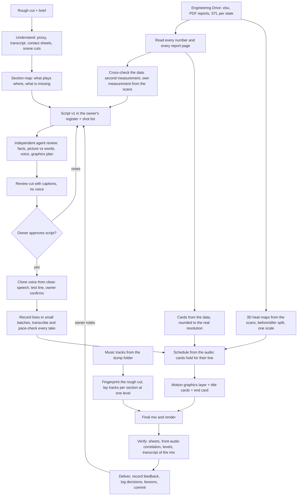

# Long-form data video

Worked example: `projects/miata-bracing-longform/` ("Does chassis bracing actually do anything?", 8 versions with the
owner). Its knowledge graph is in `graphify-out/` (`graphify query "<question>"`, or open `graphify-out/graph.html`).
Read `CLAUDE.md` and `knowledge/lessons.md` first; the Miata section there is the short form of this skill.

## Pipeline

## Steps

1. **Take stock.** Download the rough cut (Dropbox MCP `download_link`, not the share URL) and everything in the car's
   Drive folders. Make a 720p proxy, 16 kHz audio, a transcript (`tools/transcribe.py`), contact sheets
   (`tools/sheet.py <video> <t0> <t1> <step> <cols> out.jpg`) and scene cuts. Write `clips.md`: a time map of the rough
   cut, where the voice stops, shoot order vs story order, burned-in titles, and the data.
2. **Read the data before writing a word.** PDFs are often image-only: render pages and look. Note every colour-scale
   range. Then look for a second measurement of the same thing, and measure it yourself from the scans
   (`tools/towerspread.py`, `tools/heat.py --asis`). If two definitions disagree, the script may not rank anything.
3. **Script.** Write from the owner's on-camera transcript (their openers, fillers, questions), one line per shot,
   every number traceable to a file. Keep lines under shop footage to about 2.5 words/s. Generate `script.md` from the
   same list the build reads (`tools/build.py`: `TL` + `NAR`), never by hand.
4. **Agent review, twice.** Spawn a general-purpose agent with the script, cut, data and transcript; ask for blocking
   issues, line rewrites and a graphics plan (`agent_review.md` shows the brief and the result). Fix, then get a
   sign-off pass. Do not send the owner a script the reviewer has not passed.
5. **Review cut.** Captions only, timecode burned in, `tools/build.py`. Give the owner the typed script and shot list.
   Voice work starts only after they approve the script.
6. **Voice.** Clone from the cleanest 60-90 s of the owner's own speech (skip noisy stretches), make one test line,
   wait for "that sounds like me". Then record all lines (`tools/vo.py` spells numbers out). Quote the cost from
   `get_cost` on the longest line times the count. Submit about five at a time. Transcribe every take; re-roll takes
   outside roughly 2.6-4.3 words/s or with a wrong word; never stretch more than 10 %.
7. **Graphics.** Cards from the data (`tools/cards.py`), 3D heat maps from the scans (`tools/heat3d.py prep|shot`),
   intro explainer (`tools/flexgfx.py`), tracked callouts (`tools/callout.py`), and the motion layer over everything
   after the voice hand-over (`tools/fx.py`): scan tracker, shot chips, count-up deltas, table sweeps, staged reveals,
   section title cards, end card with logos.
8. **Music.** Ask for, or look for, the music folder before reconstructing anything from the mix. Fingerprint the rough
   cut against the supplied tracks, then lay the real tracks per section at one level with crossfades (planner in
   `tools/final.py`). Leave the rough cut's own mix untouched where its voice is.
9. **Assemble.** `tools/final.py <media_dir> <out.mp4>`: schedule from the audio, frame-exact segments, voice level
   and tone, bed, subtitles in the rough cut's style, graphics pass.
10. **Verify before sending.** Contact sheets of every section; correlation of the untouched audio against the rough
    cut; speech level against the owner's real voice; quietest second of the bed; a transcript of the final mix. State
    plainly that audio was checked by measurement and transcription, not by ear.
11. **Close the loop.** `ive feedback` for every note, `ive log` for every decision with its why, lessons into
    `knowledge/lessons.md`, commit and push. Rebuild the graph with `/graphify projects/<project>` when the project is done.

## Rules the owner set on the Miata video

- Narration must sound like the owner. Tight copywriter sentences were rejected.
- Data on screen and in the voice at the measurement's real resolution (0.1 mm there). If rounded values and the rounded
  difference disagree, speak only the differences and footnote the table.
- Heat maps come from the actual 3D scans, animated, as before/after on the same camera with one scale.
- Sections get their own title card. Data sections need motion on screen.
- Conclusions short: what worked, what the data cannot rank, what would settle it. Hypotheses are labelled as such.
- Music plays continuously at an even level; it is not ducked to silence under cards.
- Credits and handles are the owner's call: ask for partner names, logos and social handles rather than guessing.
- Explicit owner requests override the reel rule against text over shop footage (callouts, handles, chips).

## Things that went wrong, so check them

- A rebuilt mix shipped with the wrong three minutes of audio up front. Correlate, do not just measure loudness.
- Stills made with `-loop 1 -t` run long; thirty cards drifted the picture a second. Cut segments by frame count.
- Report screenshots used two colour scales. One scale everywhere, or say so on screen and in the line.
- Tone-matching a cloned voice to a noisy reference adds treble. Cut-only above 3 kHz.
- A voice service's test-line price did not predict the full read. Budget from the longest line.
- A third-party installer (`graphify install`) also adds hooks and edits `CLAUDE.md`. Read what it wrote before committing.

## Starting a new long-form project

Copy `projects/miata-bracing-longform/tools/` into `projects/<new>/tools/`, then replace the project-specific parts:
`TL` and `NAR` in `build.py`, the data tables and card names in `cards.py`, `BADGE` / `DELTA` / `HB` / labels in
`fx.py`, the scan-state names and wheel mask in `heat3d.py`, the track plan in `final.py`. Media stays in
`/home/user/media/<project>/`, never in git.
